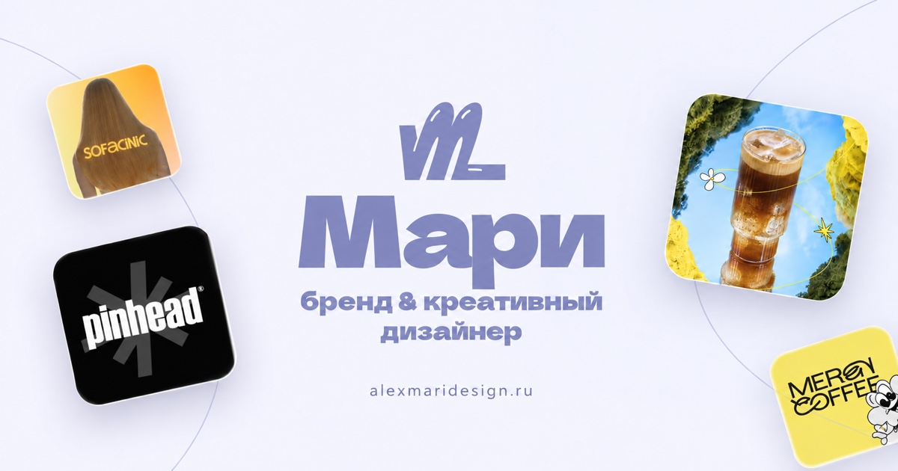

# Мари — бренд-дизайнер, иллюстратор

Сайт-портфолио Мари Алекс. Айдентика, мерч, упаковка, иллюстрации и цифровой дизайн для брендов.

**[Открыть сайт → alexmaridesign.ru](https://alexmaridesign.ru/)**

## О портфолио

На сайте собраны работы для МеренКофе, Mirai, Round, Sofacinic, Pinhead и «Друг».
Главный экран построен вокруг парной карусели: слева — компании, справа — связанные с ними работы.

Также на сайте есть услуги и стоимость, процесс работы, инструменты дизайнера и контакты для обсуждения проекта.

У каждого направления своя страница с кейсами — их открывает меню «Кейсы»: [все кейсы](https://alexmaridesign.ru/cases), [айдентика](https://alexmaridesign.ru/identity), [мерч](https://alexmaridesign.ru/merch), [иллюстрации](https://alexmaridesign.ru/illustrations) (там же листается скетчбук) и [соцсети](https://alexmaridesign.ru/social).

## Направления работы

- Айдентика и ребрендинг.
- Дизайн мерча и коллекций.
- Дизайн упаковки.
- Оформление и контент для социальных сетей.
- Печатная продукция.
- Дизайн приложений.
- Авторские иллюстрации.

## О сайте

Адаптивный сайт на HTML, CSS и JavaScript. Список кейсов и их разделы лежат в `cases-data.js` — его читают и главная, и страницы разделов. Для типографики используются Inter и Dela Gothic One; файлы шрифтов лежат в `assets/fonts`.

Сайт размещён на GitHub Pages с доменом `alexmaridesign.ru`.

Разработка — [alkislovdev](https://alkislovdev.ru/).

## Контакты

- [Telegram — @alexmari_a](https://t.me/alexmari_a)
- [Почта — i@alexmaria.ru](mailto:i@alexmaria.ru)
- [Политика конфиденциальности](https://alexmaridesign.ru/privacy)
